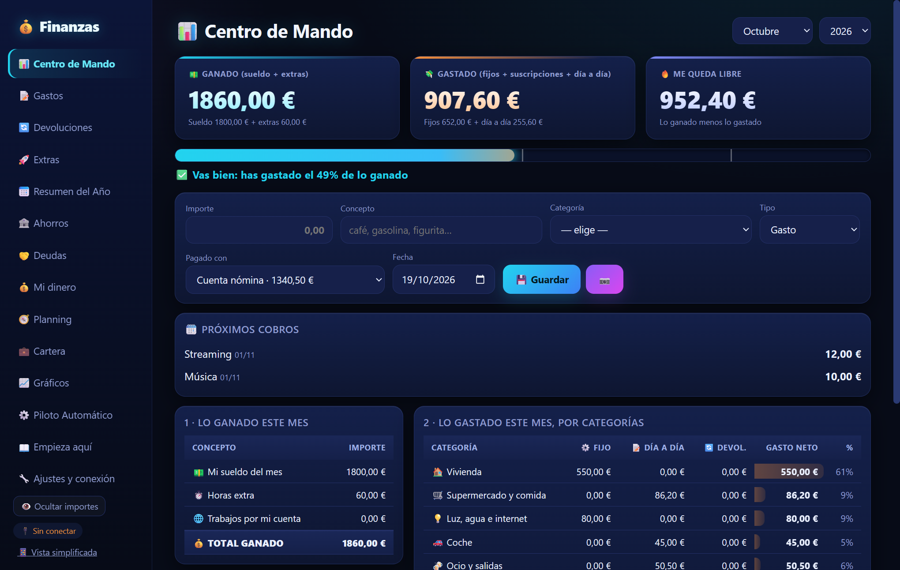
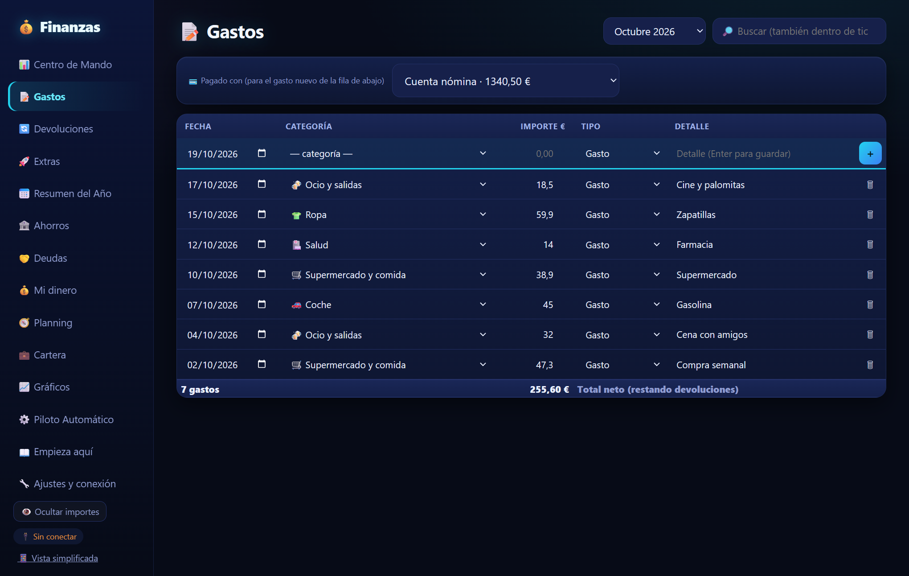
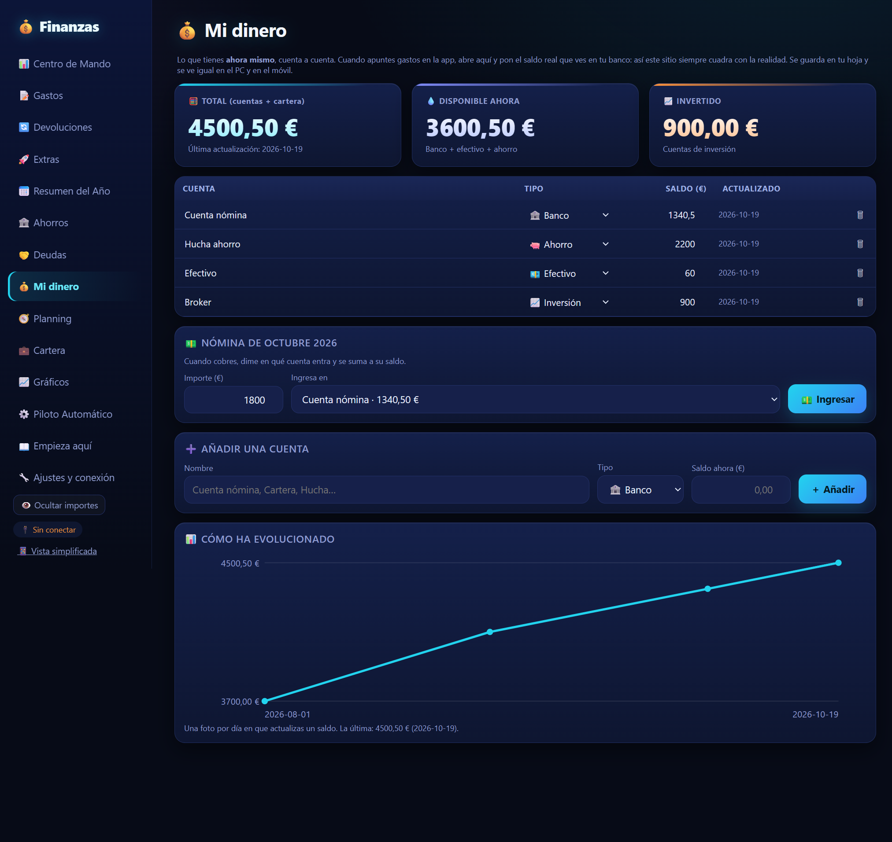
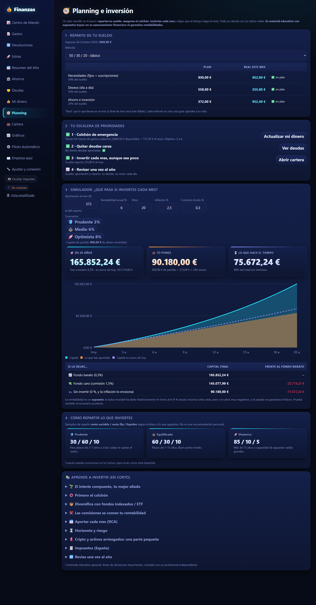
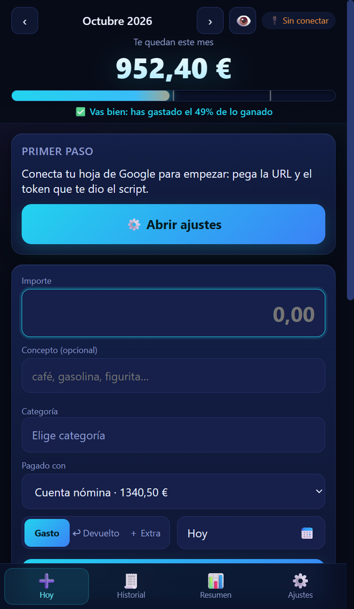

# Finanzas

A mobile-first **PWA for personal expenses** that talks to **your own Google Sheet**. Two things it is built to do well:

1. **Log a small expense in 3 seconds**: amount, concept, done. The category is picked for you from your own habits dictionary.
2. **"X-ray" a big receipt**: take a photo of a 170 € shopping ticket and Gemini itemises it line by line, so you see exactly where each euro went (e.g. 110 € groceries, 35 € home decor, 25 € gifts), and you save it split by category or as a single row with the full breakdown inside.

Plus a permanent **"how much do I have left this month"** header, offline support, and `.xlsx` import/export.

> **Live app:** https://imsothe.github.io/Finanzas/ (the UI only; it holds no data. You connect it to *your* Google Sheet.)
> The UI is in Spanish. Built with AI-assisted development (Claude); behaviour is pinned by the automated tests listed below.

```
┌───────────────┐  fetch   ┌──────────────────────┐   read/write    ┌───────────────┐
│  PWA (phone)  │ ───────► │ Google Apps Script   │ ──────────────► │ Google Sheets │
│  app/         │ ◄─────── │ backend/Code.gs      │ ◄────────────── │ (your data)   │
└──────┬────────┘   JSON   └──────────────────────┘                 └───────────────┘
       │ receipt photo (compressed JPEG, sent directly)
       ▼
  Gemini API (gemini-2.5-flash)
```

Everything runs on Google's servers and GitHub Pages, so **your computer does not need to be on**: it works anywhere your phone has data.

## Screenshots

*Demo data only.*

| Command Center (PC) | Expenses with "Paid with" account |
|---|---|
|  |  |

| My money (accounts and balances) | Planning and investing |
|---|---|
|  |  |

| Phone: log an expense | Settings: connect your sheet |
|---|---|
|  |  |

## Features

| | |
|---|---|
| **3-second entry** | Amount + concept + Save. Typing `caf`, `figu`, `moto`… suggests and **auto-selects the category** (shown as *auto ✨*, tap to change). Changing a category teaches the dictionary, and it is saved to your sheet. |
| **Quick chips** | One-tap buttons for your most repeated expenses (with the last amount as a hint). |
| **Receipt X-ray** | Photo → per-article list with a suggested category each, a grouped summary with percentages, tap any line to recategorise. Strict-JSON request to Gemini with a response schema whose categories are your real ones. |
| **Two ways to save a receipt** | **Split**: one sheet row per category (the last one absorbs rounding so the rows add up *exactly* to the ticket total) with the items of that category in `Detalle_Items`. **Single row**: the full total with the whole breakdown stored inside. |
| **Mismatch guard** | If the items don't add up to the ticket total, an explicit *adjustment* line is added and you are warned. |
| **History search** | Searches concept, category, store **and the articles inside receipts** ("cheese", "figurine"). Tapping a receipt expense opens the full itemised ticket. |
| **How much is left** | Same maths as the spreadsheet it came from: `income (salary + extras) − fixed costs − active subscriptions − day-to-day expenses + refunds`, with a battery bar and traffic light (green ≥ 20 %, yellow < 20 %, red ≤ 0). |
| **Summary** | Month totals and a bar per category (against a budget if you set one). |
| **Offline-first** | Entries are applied locally and queued; they are sent when the network returns, **exactly once** (retries are idempotent by ID). The app also opens with no connection. |
| **Excel** | One import reads your whole workbook: *Gastos*, *Extras* (with hours), *Deudas*, *Ahorros* and the *Piloto Automático* (categories, salary, fixed costs, subscriptions, extra types). Re-importing never duplicates. Export gives back an `.xlsx`. |
| **Desktop view** | On wide screens (≥ 1000 px) the same app switches to the **Advanced mode**, a spreadsheet-like layout with a sidebar: *Command Center* (income / spending / what's left, battery bar with alarm from 80 % spent, quick-add bar, per-category table), an **editable expenses grid**, *Refunds*, *Extras* (hours × rate or fixed pay), *Year summary* (12 months + savings rows), *Savings*, *Debts* (who owes me / whom I owe) and *Autopilot* (edit salary, fixed costs per month, subscriptions, extra types, hourly rate). On the phone every section opens as a full page from Settings → More sections. Same data on both. Switch with the “Simplified view” / “Advanced mode” buttons, or force one under Settings → View. |
| **Savings & debts** | Savings grow by themselves each month (`income − spending + invested/saved`) from the month you start counting, and carry over into the next year. Debts track what was lent/borrowed and what is still pending. Both are stored in the sheet's Config tab, so phone and PC stay in sync. |
| **Real subscriptions** | Monthly, quarterly, half-yearly, yearly or **every N months**, with the **day** and the **month** of a charge, in any category (car insurance goes to *Car*). **Shared** ones count only your share (price ÷ people). Count them **spread over the months** (a 120 € yearly = 10 €/month) or **in the month they are charged** (120 € at once) — your choice. A *Next charges* card shows what is coming. |
| **Budgets** | Set a monthly limit per category (Autopilot). Each category shows a thin bar; you get a warning the moment an expense takes you past **80 %** and another past **100 %** (only once, not on every expense). |
| **Charts** | Spending by category (donut) and 12 months of earned vs spent with the leftover line. Plain SVG, no libraries. |
| **Savings goals** | “500 € for the trip” with a progress bar, what is missing and how much to put aside per month until the date you choose. |
| **PIN lock & backup** | Optional PIN (4–8 digits, stored only as a salted SHA-256 hash) asked on open and after a minute away — it keeps the curious out, but browser data is not encrypted. One-click **backup download** (JSON) and **restore** that only adds what is missing. |
| **Welcome wizard & tour** | First run: 4 short screens (monthly salary → which categories you use → where to keep the data → done, showing what is left this month), with *Skip* always visible and a one-click *import my Excel* path. Then a spotlight tour of the real screen (separate steps for Advanced mode and the Simplified view). Also a *Start here* checklist that ticks itself from your data. No Google Sheet needed to start. |
| **Hide amounts** | An eye button blurs every amount (including the confirmation toast); the choice is remembered. |
| **Year summary: until today / full year** | By default it only counts months up to the current one; switch to *Full year* to see the forecast of the remaining months. |
| **Portfolio** | Positions (crypto, stocks, ETFs, other) with quantity and average buy price → current value, profit/loss in € and %, 24 h change and allocation. Crypto prices are live (CoinGecko, no key); US stocks/ETFs live with an optional free Finnhub key (converted to € with Frankfurter), or type the price by hand. Last prices are cached for offline. Informative data, possibly delayed — not financial advice. |
| **Cheaper receipt scan** | The model answers with category *numbers* and short keys, thinking is switched off on 2.5 Flash, the prompt has no emojis and gives usage examples per category (engine oil ≠ cooking oil, a mouse is a peripheral), and the photo is sent at 1280 px. |
| **Excel mode (optional)** | The Apps Script backend can also write straight into a Google Sheets copy of an Excel template (tabs `📝 Gastos` + `⚙️ Piloto Automático` are auto-detected) without touching its formulas. |
| **Config link** | Copy a one-tap setup link from Settings and open it on another phone, so you never type the long token by hand. |

## Quick start (about 10 minutes)

> 📖 **New to Google Apps Script?** Follow the detailed [step-by-step guide](docs/SETUP.md): what to copy, where, and the common errors.

You need a Google account. Nothing here costs money (Gemini has a free tier).

### 1. Create the backend (Google Sheets + Apps Script)
1. Create a new Google Sheet ([sheets.new](https://sheets.new)).
2. **Extensions → Apps Script**. Delete the default code and paste the contents of [`backend/Code.gs`](backend/Code.gs). Save.
3. Reload the sheet. A **💰 Finanzas App** menu appears. Run **1. Configurar (crear pestañas y token)** and accept the permissions (Google warns *"unverified app"* the first time because it is your own script: *Advanced → Go to…*).
4. A dialog shows your **TOKEN**. Copy it.
5. **Deploy → New deployment → Web app**. *Execute as:* **Me** · *Who has access:* **Anyone**. Copy the `/exec` URL.

> The URL is public but **every operation requires the token**. After editing `Code.gs` you must redeploy (*Manage deployments → Edit → New version*).

### 2. Connect the app
1. Open https://imsothe.github.io/Finanzas/ on your phone (or host the `app/` folder yourself, see below).
2. **Ajustes (Settings)** → paste the `/exec` URL and the token → *Probar* (Test).
3. Optional, for the receipt scanner: paste a **Gemini API key** ([Google AI Studio](https://aistudio.google.com/apikey)). Default model: `gemini-2.5-flash`.
4. **Install it**: Android/Chrome → ⋮ → *Install app*. iPhone/**Safari** → Share → *Add to Home Screen*, then open it from the icon. The installed iPhone app keeps its data apart from Safari, so connect it again by pasting the config link in **Ajustes** (details in [docs/SETUP.md](docs/SETUP.md#install-it-on-the-phone)).
5. For a second phone: **Ajustes → 🔗 Enlace para configurar otro móvil**, send the link to yourself and open it there (or paste it into **Ajustes** inside the installed app).

> [!IMPORTANT]
> **iPhone: the installed app looks like a "new user". That is normal and takes 2 minutes to fix.**
> It keeps its data apart from Safari, but your data is still in your Google Sheet. To connect it:
> 1. On the PC: **Ajustes → 🔗 Enlace para configurar otro móvil → 📋 Copiar**, and send it to yourself (never share it: it contains your token).
> 2. On the iPhone, open the app **from the icon** (not from Safari). On the welcome screen tap **"Saltar, ya sé usarla"** (skip).
> 3. Tap **⚙️ Ajustes** (bottom right) and scroll to **"Conexión con tu hoja de Google"**.
> 4. Copy the link from the message (long-press → **Copy**, without tapping it), go back to the app and **paste** it into the box *"¿Tienes un enlace de configuración? Pégalo aquí"* (long-press → **Paste**).
> 5. Tap **Usar** → **Conectar** and wait until the top right says **Sincronizado**.
>
> If it says *"Ese texto no es un enlace de configuración"*, copy the whole link (it starts with `https://imsothe.github.io/Finanzas/#c=`). If you do not see the box you have an old cached version: delete the icon and reinstall it from Safari. Full guide: [docs/SETUP.md](docs/SETUP.md#install-it-on-the-phone).

### 3. Start from your own Excel (optional)
`tools/build_seed.py` reads your spreadsheet and creates a personalised `Code.gs` that seeds your categories, salary, fixed costs, subscriptions and a habits dictionary taken from your history:
```bash
pip install openpyxl
python tools/build_seed.py "path/to/your_finance_sheet.xlsx"   # -> seed/seed.json  (git-ignored)
python tools/build_gs.py                                       # -> dist/Code.gs    (git-ignored, paste this one)
```
Or just use **Ajustes → Importar .xlsx** to bring your history in.

## Managing it day to day

You manage everything **from the Google Sheet itself**; the app picks changes up on its next sync (every 30 s while open, when you return to it, or via *Ajustes → Sincronizar*).

| I want to… | Do this |
|---|---|
| **Add / rename a category** | Sheet tab `Config` → row `categorias` → edit the JSON list. Keep the exact text if existing expenses use it (renamed categories show as *Sin categoría* until you recategorise). |
| **Set my salary / change it** | `Config` → `sueldo`: a series `[{"desde":"2026-10","importe":1500}]`. A value **applies from that month onward** until a later one; before the first month it is 0. Raise in May? Add `{"desde":"2027-05","importe":1650}`. |
| **Fixed monthly costs** (rent, insurance…) | `Config` → `fijos`: `{"🏠 Housing":[{"desde":"2026-01","importe":600}]}` (same "from this month on" logic). |
| **Subscriptions** | `Config` → `suscripciones`: `[{"nombre":"Streaming","importe":9.99,"activa":true}]`. They are summed into the category whose name contains "Suscripci…". Set `"activa":false` to stop counting one. |
| **Budget per category** | In `categorias`: `{"nombre":"🍻 Leisure","presupuesto":150}` → the summary bar shows % of budget and turns red when exceeded. |
| **Extra income types** | `Config` → `tiposExtra`. Extra income is logged from the main form's **＋ Extra** switch. |
| **Fix or delete an expense** | In the app: History → tap it → *Change category* / *Delete*. Or edit/delete the row in the `Gastos` tab (rows typed by hand get an ID automatically). |
| **Edit what the app learned** | Settings → *Diccionario de costumbres* (✕ deletes an entry), or the `Diccionario` tab. Origins: `historial` (from your spreadsheet), `app` (learned from you, weighs most), `semilla` (generic starter words). |
| **Back up / leave** | Settings → *Exportar .xlsx*. Google Sheets also keeps **version history** (File → Version history). |
| **Lost your phone** | Menu **💰 Finanzas App → Regenerar el token**, then re-link your devices. |
| **Update the app** | Nothing to do: the web app updates on its own (network-first service worker). The backend only changes if *you* redeploy `Code.gs`. |
| **Self-host the web app** | Serve the `app/` folder from any static HTTPS host (GitHub Pages, Netlify, Cloudflare Pages). HTTPS is required for the camera and installation. |

### Sheet layout

| Tab | Columns / content |
|---|---|
| `Gastos` | Fecha · Categoría · Importe · Tipo (`Gasto` / `Devolución 🔄`) · Detalle · Comercio · **Detalle_Items** (JSON breakdown) · TicketID · Origen · ID · Creado |
| `Extras` | Fecha · Tipo de extra · Importe · Detalle · ID · Creado |
| `Config` | `categorias`, `sueldo`, `fijos`, `suscripciones`, `tiposExtra` (JSON); `ahorro` is reserved for future use |
| `Diccionario` | word → category · times used · origin |

### Troubleshooting

| Symptom | Likely cause |
|---|---|
| "Token incorrecto" | Token pasted wrong or regenerated. Menu *Mostrar el token*. |
| *Probar* says it cannot connect (CORS error in the console) | Deployment must be **Anyone** (not "Anyone with a Google account"), or you edited `Code.gs` without redeploying a new version. See [docs/SETUP.md](docs/SETUP.md). |
| Receipt scan: "API key not valid" | Wrong/expired Gemini key, or the key lacks access to the model. |
| Receipt scan: rate limit | Gemini free tier quota; wait a minute. |
| Numbers differ from my spreadsheet | Check `Config` (`sueldo`, `fijos`, `suscripciones`) and that categories match exactly. |

> 🔒 Security model, hardening and known limits: see [SECURITY.md](SECURITY.md).

## Security & privacy

- The token is the only secret protecting your sheet through the public web-app URL. **Don't share the setup link or the token.** If leaked, regenerate it.
- The **token and the Gemini key are stored only in your browser**. The photo goes **directly to Google (Gemini)**, compressed; it never touches any server of mine. Restrict your key in AI Studio if you can.
- Receipt text is treated as **data, not instructions** (the prompt says so), and everything coming from the sheet or the AI is **HTML-escaped** before rendering (tested with hostile payloads).
- The config link only accepts Google Apps Script hosts and always asks for confirmation, so a crafted link cannot silently redirect your data.
- Single-user design: one sheet, no accounts or permissions.
- **Hardened (see [SECURITY.md](SECURITY.md))**: strict Content-Security-Policy (no inline scripts, no `eval`, fixed network destinations); the token travels only in POST bodies, never in a URL; the script writes everything external as **plain text** so `=IMPORTDATA(…)`-style formula injection cannot run in your sheet; strict validation of IDs, sizes and config schemas; the script can only touch **this** spreadsheet (`@OnlyCurrentDoc`); vendored SheetJS ≥ 0.20.2; GitHub Actions pinned by commit; PIN hashed with PBKDF2 and rate-limited. If your Apps Script is older than this version the app keeps working but warns you to paste the new `Code.gs`.
- This repository contains **no personal data**: your categories, salary and dictionary live in your own sheet.

## What is tested, and what is not

**Tested automatically** (`npm test`, 136 tests): the Apps Script backend run unmodified against an in-memory sheet (auth, idempotent adds, validation, update/delete, dictionary, config), the pure core (monthly maths, autocomplete, dictionary precedence, receipt normalisation and exact split sums, search inside receipts, Excel import ids, subscriptions, budgets, savings, portfolio maths) and **security tests** (formula injection in the sheet, hostile backups and configs, token handling, CSP and workflow guards). **Also driven end to end in a browser** emulating a phone against a local server running the real `Code.gs`: 3-second entry, learning, both receipt save modes, offline queue replay without duplicates, offline start, Excel import/export, Gemini error handling and the config link.

**Not verified in the real world yet:**
- Long-term use on a real Google Apps Script beyond the author's own sheet (it has been deployed and used from a PC and an installed phone PWA, but not by other people yet).
- **Gemini on real receipt photos**: reading accuracy depends on the photo. Only the request format was confirmed (Google's API accepted the call and rejected a fake key); the response was simulated.
- Installation and camera behaviour on real iPhone/Android devices.
- Performance with many thousands of rows.

## Development

```bash
npm test        # backend (simulated sheet) + core logic
npm run dev     # http://127.0.0.1:8777 with a simulated sheet and a simulated Gemini (token printed in the console)
```
`app/core.js` has no DOM code: all business logic lives there and is what the tests exercise. `app/app.js` is the UI and sync layer. No build step.

## Credits & licence

MIT, see [LICENSE](LICENSE). Bundles [SheetJS](https://sheetjs.com) (Apache-2.0) in `app/vendor/`. Receipt reading uses Google's Gemini API under your own key and Google's terms. Spanish guide: [README.es.md](README.es.md).
