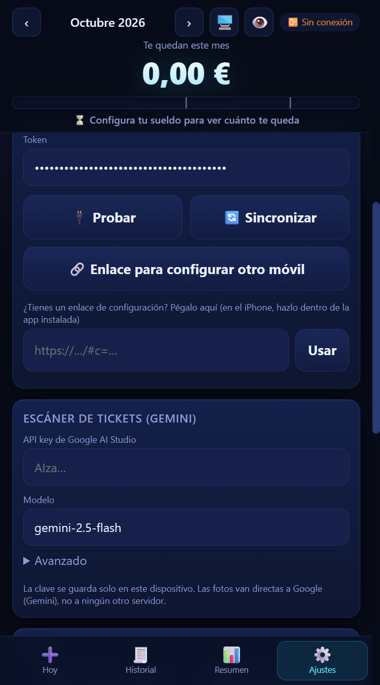

# Guía paso a paso: conectar la app con tu Google Sheet

Tiempo: unos 10 minutos, **una sola vez**. Después, la app del móvil y la del PC comparten los mismos datos.

Hay **tres sitios distintos** y es fácil confundirlos:

| Sitio | Qué es | Para qué lo usas |
|---|---|---|
| **La hoja de Google** (sheets.new) | Tu hoja de cálculo | Menú **💰 Finanzas App**: sacar el token |
| **Apps Script** (Extensiones → Apps Script) | El editor de código de la hoja | Pegar `Code.gs` e **Implementar** (sacar la URL) |
| **La app** (imsothe.github.io/Finanzas) | La app de gastos | **Ajustes**: pegar la URL y el token |

Vas a **copiar dos cosas de Google** (el *token* y la *URL*) y pegarlas en la app.

## Paso 1 · Crear la hoja
Abre **https://sheets.new**. Ponle un nombre (por ejemplo «Finanzas»). Usa tu cuenta personal de Gmail y, si tienes varias cuentas abiertas, mejor una ventana de incógnito con una sola.

## Paso 2 · Pegar el código
1. En la hoja: **Extensiones → Apps Script** (se abre otra pestaña).
2. Borra el código que haya y pega el contenido de `Code.gs` (el genérico está en `backend/Code.gs`).
3. Pulsa el disquete **Guardar** (Ctrl+S).

## Paso 3 · Sacar el TOKEN (en la hoja, no en la app)
1. Vuelve a la pestaña de la hoja y **recárgala** (F5). Tras unos segundos aparece un menú nuevo al final de la barra: **💰 Finanzas App**.
2. Menú **💰 Finanzas App → 1. Configurar (crear pestañas y token)**.
3. Google pide permisos. Si dice *«Google no ha verificado esta aplicación»*: **Configuración avanzada → Ir a … (no seguro) → Permitir**. Es tu propio script.
4. Sale una ventana «Listo ✅» con el **token** (una cadena larga). **Cópialo** y guárdalo en un bloc de notas. Si lo pierdes: menú 💰 Finanzas App → *Mostrar el token*.
5. Se crean las pestañas Gastos, Extras, Config y Diccionario.

## Paso 4 · Sacar la URL (en Apps Script)
1. En la pestaña de Apps Script: botón azul **Implementar** (arriba a la derecha) → **Nueva implementación**.
2. Pulsa el engranaje ⚙️ junto a *Seleccionar tipo* → **Aplicación web**.
3. **Ejecutar como: Yo** (tu correo).
4. **Quién tiene acceso: Cualquier usuario.**
   > ⚠️ **No** elijas «Cualquier usuario con cuenta de Google» ni «Solo yo»: con esas opciones el navegador bloquea la app (error CORS) y no conecta.
5. **Implementar** → autoriza los permisos otra vez si los pide.
6. Copia la **URL de la aplicación web**. Tiene que ser así: `https://script.google.com/macros/s/…/exec`.
   Si la perdiste: **Implementar → Administrar implementaciones**.

**Comprobación:** abre esa URL en una **ventana de incógnito**. Debe salir `{"ok":true,"app":"FinanzasApp"}` sin pedirte iniciar sesión.

## Paso 5 · Conectar la app
1. Abre la app → **Ajustes → Conexión con tu hoja de Google**.
2. Pega la **URL** y el **token** (sin espacios al principio ni al final).
3. Pulsa **Probar**. Debe decir **✅ Conectado correctamente**.
4. Pulsa **Sincronizar**.

## Paso 6 · El móvil
### Instalarla en el móvil
- **iPhone:** tiene que ser en **Safari** (en Chrome de iPhone no se puede instalar bien). Abre la web → botón **Compartir** (cuadrado con flecha hacia arriba) → baja y pulsa **«Añadir a pantalla de inicio»** → **Añadir**.
- **Android:** en Chrome, menú ⋮ → **Instalar app** (o «Añadir a la pantalla de inicio»).
- Ábrela siempre desde **el icono**. Se abre sola, a pantalla completa y sin barra de direcciones: no abre ningún navegador, aunque tengas otro por defecto.
- Instalada, el iPhone no borra sus datos por no usarla (en Safari sí los borra si pasas ~7 días sin abrirla).

### Conectarla con tu hoja

> [!IMPORTANT]
> **iPhone: la app instalada sale como «usuario nuevo». Es normal y se arregla en 2 minutos.**
> La app instalada guarda sus datos aparte de Safari, pero **tus datos siguen en tu hoja de Google**: solo hay que conectarla.
> Un enlace tocado desde WhatsApp o Mensajes se abre en tu navegador por defecto, **no** dentro de la app instalada. Por eso el enlace se **pega** dentro de la app.

1. **En el PC:** Ajustes → **🔗 Enlace para configurar otro móvil** → **📋 Copiar**.
2. **Mándatelo a ti mismo** (WhatsApp «Mensajes guardados», un email…). **No lo compartas: lleva tu token.**
3. **En el iPhone,** abre la app **desde el icono** (no desde Safari). Si sale «Bienvenido», pulsa el texto pequeño **«Saltar, ya sé usarla»**.
4. Toca **⚙️ Ajustes** (la última pestaña de abajo, a la derecha) y baja hasta la tarjeta **«Conexión con tu hoja de Google»**.
5. Debajo del botón «🔗 Enlace para configurar otro móvil» verás **«¿Tienes un enlace de configuración? Pégalo aquí»** y una casilla con el botón **Usar** (arriba a la derecha de esa tarjeta pone **«versión 36»** o superior; si no pone versión, tienes la app antigua).

6. **Copia el enlace:** sal un momento a WhatsApp o Mensajes, mantén el dedo sobre el mensaje → **Copiar** (sin tocarlo para abrirlo).
7. **Vuelve a la app** (desde el icono) → Ajustes, toca la casilla, mantén pulsado y elige **Pegar**.
8. Pulsa **Usar**. Sale **«¿Conectar esta app?»** → **Conectar**.
9. **Espera unos segundos:** arriba a la derecha debe poner **Sincronizado** y aparecen tus gastos y categorías.

**Si algo no sale**

| Qué ves | Qué hacer |
|---|---|
| «Ese texto no es un enlace de configuración» | Copiaste otra cosa. Copia el enlace entero: empieza por `https://imsothe.github.io/Finanzas/#c=`. |
| No existe la casilla del enlace | Tienes una versión antigua guardada. Borra el icono (mantén pulsado → Eliminar app), abre la web en Safari y vuelve a instalarla. |
| No pasa a «Sincronizado» | Mira el indicador de arriba. Revisa que la implementación de tu hoja sea **Cualquier usuario** (ver el paso 4). |

Alternativa: teclear la URL y el token a mano en los dos campos de arriba de Ajustes.

## Paso 7 · Traer tu Excel (opcional)
**Ajustes → Importar .xlsx** → elige tu archivo. Te enseña un resumen antes de importar y no duplica si lo repites.

---

## Errores típicos

| Qué ves | Causa y arreglo |
|---|---|
| No encuentro «Configurar» en la app | Está en el **menú de la hoja de Google** (💰 Finanzas App), no en la app. Recarga la hoja con F5 si no sale el menú. |
| «La URL debe ser de Google Apps Script» | Pegaste la URL de la hoja o del editor. Debe empezar por `https://script.google.com/macros/s/` y acabar en `/exec`. |
| «No se pudo implementar» | Cuenta equivocada o de trabajo. Usa una ventana de incógnito con **una sola cuenta personal**, ejecuta `setup` desde el editor, autoriza y repite. |
| «No se pudo conectar» + error **CORS** en la consola (F12) | La implementación no es **Cualquier usuario**. Implementar → Administrar implementaciones → ✏️ → Quién tiene acceso: Cualquier usuario → Versión: Nueva versión → Implementar. |
| «Token incorrecto» | Token mal copiado o con espacios. Menú 💰 Finanzas App → *Mostrar el token*. |
| «No se pudo sincronizar» | Cambios pendientes que no se enviaron o el script devolvió un error. Abre **Empieza aquí → 🩺 Diagnóstico**: dice qué responde tu hoja. |
| Cambié `Code.gs` y no se nota | Hay que volver a implementar: Administrar implementaciones → ✏️ → **Nueva versión**. |
