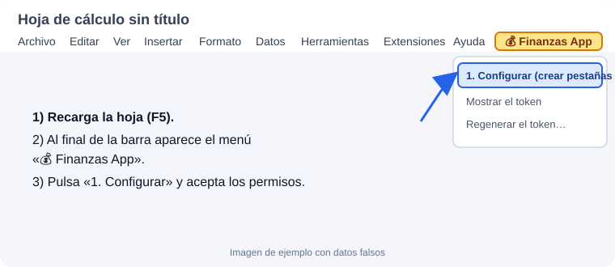
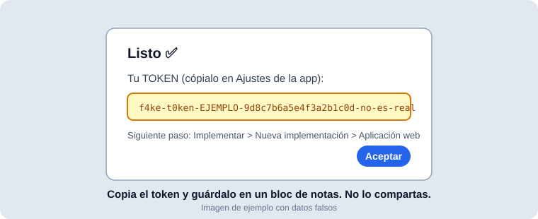
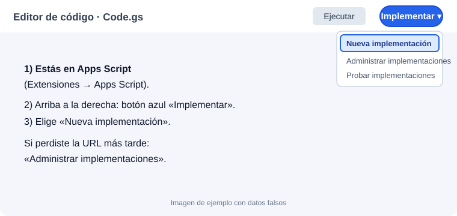
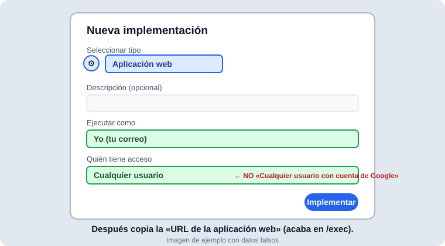
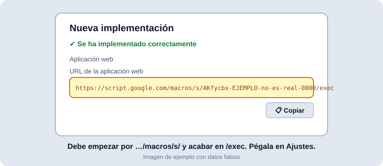
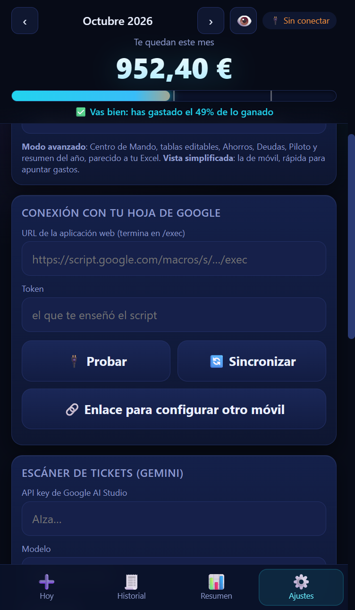

# Step-by-step: connect the app to your Google Sheet

About 10 minutes, **once**. After that the phone app and the PC app share the same data.

There are **three different places**, which is the usual source of confusion:

| Place | What it is | What you do there |
|---|---|---|
| **The Google Sheet** (sheets.new) | Your spreadsheet | Menu **💰 Finanzas App**: get the token |
| **Apps Script** (Extensions → Apps Script) | The sheet's code editor | Paste `Code.gs` and **Deploy** (get the URL) |
| **The app** (imsothe.github.io/Finanzas) | The expense app | **Ajustes (Settings)**: paste URL and token |

You copy **two things from Google** (the *token* and the *URL*) and paste them into the app.

## 1 · Create the sheet
Open **https://sheets.new** and name it. Use a personal Google account; with several accounts logged in, use an incognito window with only one.

## 2 · Paste the code
1. In the sheet: **Extensions → Apps Script**.
2. Delete the default code and paste `Code.gs` (generic one: `backend/Code.gs`). Save (Ctrl+S).

## 3 · Get the TOKEN (in the sheet, not in the app)
1. Go back to the sheet tab and **reload** it (F5). A **💰 Finanzas App** menu appears at the end of the menu bar.
2. **💰 Finanzas App → 1. Configurar (crear pestañas y token)**.
3. Accept the permissions. If Google warns *"unverified app"*: **Advanced → Go to … (unsafe) → Allow**. It is your own script.
4. A "Listo ✅" dialog shows the **token**. Copy it. Lost it? Menu → *Mostrar el token*.

## 4 · Get the URL (in Apps Script)
1. Blue **Deploy** button (top right) → **New deployment**.
2. Gear ⚙️ next to *Select type* → **Web app**.
3. **Execute as: Me.**
4. **Who has access: Anyone.**
   > ⚠️ **Not** "Anyone with a Google account" and not "Only myself": with those the browser blocks the app (CORS error) and it cannot connect.
5. **Deploy**, authorise again if asked.
6. Copy the **Web app URL**: `https://script.google.com/macros/s/…/exec`. Lost it? **Deploy → Manage deployments**.

**Check:** open that URL in an **incognito window**. You must see `{"ok":true,"app":"FinanzasApp"}` without any login.

## 5 · Connect the app
1. App → **Ajustes → Conexión con tu hoja de Google**.
2. Paste the **URL** and the **token** (no leading/trailing spaces).
3. **Probar** must say **✅ Conectado correctamente**. Then **Sincronizar**.

## 6 · Your phone
### Install it on the phone
- **iPhone:** it must be **Safari** (Chrome on iPhone cannot install it properly). Open the site → **Share** button (square with an up arrow) → scroll and tap **"Add to Home Screen"** → **Add**.
- **Android:** in Chrome, ⋮ menu → **Install app** (or "Add to Home screen").
- Always open it from **the icon**. It opens by itself, full screen, with no address bar: it does not open any browser, even if you have another one as default.
- Once installed, iOS does not wipe its data for not using it (in plain Safari it does, after ~7 days without opening it).

### Connect it to your sheet
> ⚠️ **On iPhone the installed app keeps its data separate from Safari**, so the first time it looks like a brand-new user. That is normal: your data is still in your Google Sheet, you just have to connect it.
> A link tapped in WhatsApp or Messages opens in your default browser, **not** inside the installed app. That is why you **paste** it inside the app.

1. On the PC: **Ajustes → 🔗 Enlace para configurar otro móvil → 📋 Copiar**.
2. Send it to yourself (WhatsApp "saved messages", an email…). **Never share it: it contains your token.**
3. On the phone, open the app **from the icon**. If the welcome screen shows, tap **Saltar** (Skip).
4. **Ajustes** → field **"¿Tienes un enlace de configuración? Pégalo aquí"**: copy the link from the message (long-press → Copy, without tapping it), paste it and tap **Usar** → **Conectar**.
5. If you do not see that field you have an old cached version: delete the icon, open the site in Safari again and reinstall.

Alternative: type the URL and token by hand in the two top fields of Ajustes.

## 7 · Bring your Excel (optional)
**Ajustes → Importar .xlsx**. A summary is shown first; importing twice never duplicates.

---

## Common errors

| What you see | Cause / fix |
|---|---|
| Cannot find "Configurar" in the app | It is in the **Google Sheet's menu** (💰 Finanzas App). Reload the sheet (F5) if the menu is missing. |
| "URL must be Google Apps Script" | You pasted the sheet or editor URL. It must start with `https://script.google.com/macros/s/` and end with `/exec`. |
| "Deployment failed" | Wrong or work account. Use an incognito window with **one personal account**, run `setup` from the editor, authorise, retry. |
| "Could not connect" + **CORS** error in the console (F12) | Deployment is not **Anyone**. Deploy → Manage deployments → ✏️ → Who has access: Anyone → Version: New version → Deploy. |
| "Token incorrecto" | Token mis-copied or has spaces. Menu 💰 Finanzas App → *Mostrar el token*. |
| "No se pudo sincronizar" | Unsent changes or a script error. Open **Empieza aquí → 🩺 Diagnóstico**. |
| I edited `Code.gs`, nothing changed | Redeploy: Manage deployments → ✏️ → **New version**. |
